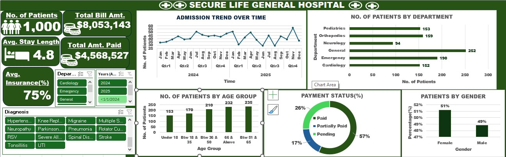

# SECURE HEALTH GENERAL PERFORMANCE DASHBOARD

## INTRODUCTION

The Secure Life General Hospital Performance Dashboard is a healthcare data analytics project developed using Microsoft Excel as part of a guided learning exercise. The project focuses on cleaning, analyzing, and visualizing hospital patient data to evaluate key aspects of hospital performance.
The dashboard provides an overview of patient statistics, hospital admissions, financial performance, departmental distribution, age-group analysis, payment status, and average length of stay. 
By transforming raw hospital records into meaningful visual insights, this project shows how data analytics can support hospital performance monitoring, improve reporting efficiency, and help management make informed decisions.

## ABOUT THE DATASET

This project uses a dataset of 1,000 hospital patient records from Secure Life General Hospital. The admission dates range from January 1, 2024, to December 28, 2025. The dataset contains 16 columns covering patient demographics, admission details, financial information, and healthcare service information.

## PROJECT STATEMENT

Hospital management requires accurate and timely information about patient activity, financial performance, and operational efficiency to make informed decisions. However, when hospital records are maintained in raw spreadsheet formats, identifying trends, monitoring outstanding payments, evaluating departmental workload, and understanding patient demographics can become difficult and time-consuming. The lack of a consolidated reporting system may limit the ability to monitor key performance indicators and identify areas requiring improvement.
This project addresses the problem by cleaning and analyzing hospital patient data and developing an Excel-based performance dashboard. The dashboard consolidates important patient, financial, and operational indicators into a visual reporting interface, making hospital performance information easier to interpret and monitor. The project aims to demonstrate how data analytics can transform raw healthcare data into actionable insights that support financial monitoring, operational planning, and evidence-based decision-making.

## VISUALISATION

## INSIGHTS

The analysis of the 1,000 patient records revealed the following insights:

1. **Patient Statistics**: The dataset contains 1,000 patient records. Of these, 508 admissions occurred in 2024, while 492 occurred in 2025. This represents a relatively similar volume of recorded admissions across the two years, with a slight decrease in the number of admissions in 2025.

2. **Financial Performance**: The total amount billed to patients was approximately $8.05 million, while the total amount paid was approximately $4.57 million. This represents approximately 56.7% of the total billed amount. The difference between the total billed amount and the total amount paid was approximately $3.48 million. This indicates a substantial gap between recorded billing and payments received, suggesting that payment reconciliation and financial monitoring may be important areas for further investigation.

3. **Departmental Distribution**: The General Department recorded the highest number of patients, with 252 records, representing 25.2% of the dataset. The Neurology Department recorded the lowest number of patients, with 94 records, representing 9.4%. This indicates that patient activity was not evenly distributed across the hospital departments.

4. **Patient Age Distribution**: The age-group analysis showed that 235 patients were between 51 and 65 years, 232 patients were aged 66 years and above, 210 patients were between 36 and 50 years, 170 patients were between 18 and 35 years and 153 patients were under 18 years. Patients aged 51 years and above accounted for 467 records, representing 46.7% of the dataset. This suggests that older adults constituted a substantial proportion of the recorded patient population.
5. **Payment Status**: The payment-status analysis revealed the following:
 - Paid: 564 patients (56.4%)
 - Pending: 257 patients (25.7%)
 - Partially Paid: 179 patients (17.9%)

Although the largest group had completed payment, 43.6% of patient records were classified as pending or partially paid. This highlights the importance of monitoring payment status and reviewing outstanding balances.

6. **Average Length of Stay**: The average recorded length of stay was approximately 4.8 days. This provides a baseline indicator for monitoring patient hospitalization duration and investigating changes in patient flow.

## RECOMMENDATION

Based on the insights generated from the dataset, the following recommendations are proposed:
1. **Strengthen Financial Monitoring**: The hospital should regularly compare total billing amounts with payments received to monitor financial performance and identify outstanding balances. A structured reconciliation process can help improve the accuracy of financial reporting.

2. **Improve Payment Follow-Up**: With 43.6% of patient records classified as pending or partially paid, the hospital should consider establishing a systematic process for reviewing outstanding payments. This may involve regular billing reviews, payment reminders, and improved documentation of payment arrangements.

3. **Optimize Departmental Resource Allocation**: The General Department recorded the highest patient volume, while Neurology recorded the lowest. Hospital management should consider departmental patient volumes when planning staffing, equipment, and other resources. However, resource allocation should also account for the complexity and severity of cases rather than relying solely on patient numbers.
 
4. **Consider the Needs of Older Patients**: Patients aged 51 years and above represented 46.7% of the dataset. The hospital may consider reviewing service needs, patient flow, and care requirements for older adults to support appropriate planning.

5. **Monitor Patient Length of Stay**: The average length of stay was approximately 4.8 days. The hospital should monitor this indicator over time and investigate factors associated with unusually long hospital stays. Any improvement efforts should prioritize patient safety and quality of care.
 
6. **Establish Regular Performance Reviews**:
The dashboard should be updated periodically to monitor changes in patient activity, financial performance, and operational indicators. Regular performance reviews can help management identify emerging trends and evaluate the effectiveness of improvement initiatives.

## CONCLUSION

The Secure Life General Hospital Performance Dashboard demonstrates the application of Microsoft Excel in healthcare data analytics. Through data cleaning, analysis, and visualization, the project transformed 1,000 hospital patient records into a structured dashboard for monitoring patient activity, financial performance, departmental distribution, and other operational indicators.
The analysis revealed a total billed amount of approximately $8.05 million, recorded payments of approximately $4.57 million, and an average length of stay of approximately 4.8 days. It also highlighted the distribution of patients across departments, age groups, and payment statuses. These findings demonstrate the value of data visualization in identifying patterns and potential areas for improvement in healthcare operations. 
As a guided learning project, this work strengthened practical skills in data cleaning, Microsoft Excel, KPI analysis, dashboard development, and data-driven interpretation. Overall, the project highlights how healthcare data analytics can support improved reporting, financial monitoring, and operational decision-making.

